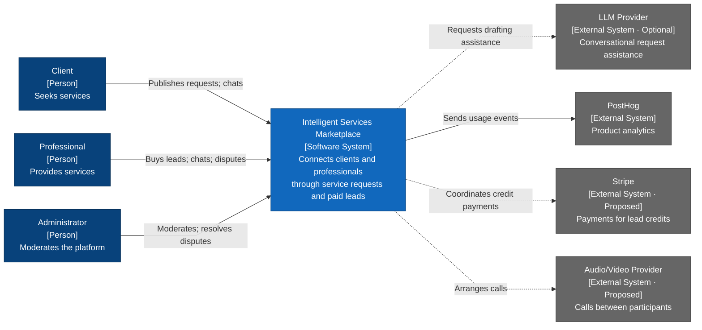

# System context diagram — C4 Level 1

This diagram describes the proposed system context of the Intelligent Services Marketplace, based on the [project proposal](project-proposal.md). It includes the core MVP, the optional semester AI prototype, and candidate payment and calling integrations. Implementation scope will be decided separately; inclusion here does not commit an integration to the semester deliverables.

Blue nodes represent people and the marketplace; gray nodes represent external systems. Solid arrows show core planned relationships; dashed arrows show optional or proposed integrations. Each arrow summarizes a relationship, including any responses, rather than individual messages.

| Relationship | Supporting details |
| --- | --- |
| Client → Marketplace | Publishes and tracks service requests and communicates with professionals. |
| Professional → Marketplace | Manages a profile, purchases leads with virtual credits, contacts clients, and submits disputes. |
| Administrator → Marketplace | Manages users, reviews requests, resolves disputes, and approves credit refunds. |
| Marketplace → LLM Provider | Sends request context and receives clarification questions and structured drafts. |
| Marketplace → PostHog | Sends product usage events without contact details or conversation content. |
| Marketplace → Stripe | Initiates credit payments and receives payment status before granting credits. |
| Marketplace → Audio/Video Provider | Creates rooms and authorizes participants. Clients and professionals join provider-hosted calls directly; these participant connections are summarized here to keep the overview readable. |

The marketplace boundary includes authentication, profiles, requests, deterministic matching, lead purchases, virtual credit balances, chat, disputes, refunds, and administration. The [Level 2 container diagram](container-diagram.md) expands its frontend, backend, and database. Internal modules belong in a Level 3 component diagram.

The LLM assists with drafting requests; the platform validates its output and requires client confirmation before publication. The traditional request form remains available when AI is disabled or unavailable. Credit charges and refunds remain controlled by the marketplace.

Stripe and the audio/video call provider are candidate extensions whose implementation remains undecided. The proposed Stripe relationship covers purchasing lead credits; payments for contracted services and Stripe Connect require a separate scope decision. LiveKit is a candidate from the proposal, and the call provider is assumed to be externally hosted for this diagram.

Mobile applications would be additional interfaces to the marketplace, while semantic matching would be an internal capability. Neither requires a separate node at this level unless it introduces another external system. PostHog is shown as an external service; its hosting arrangement is not specified in the proposal.
