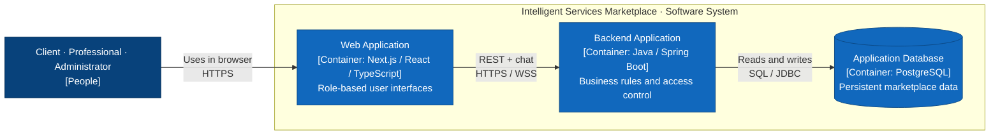
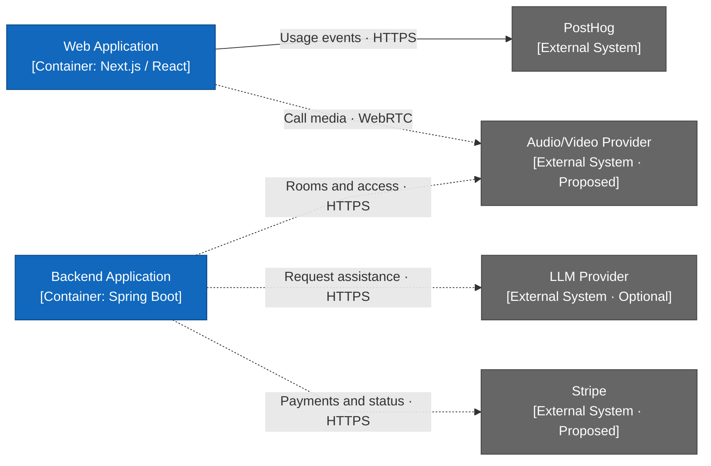

# Container diagram — C4 Level 2

This view zooms into the Intelligent Services Marketplace from the [Level 1 system context diagram](system-context.md). It describes the proposed architecture from the [project proposal](project-proposal.md), including optional AI and proposed payment and calling integrations.

The architecture is shown in two views: the core containers first, followed by their external integrations. Both views use the same web and backend containers.

## Core containers

Blue containers belong to the marketplace. Arrows summarize interactions, including responses. The three user roles share one people node to keep the layout compact.

| Container | Responsibilities |
| --- | --- |
| Web Application | Client, professional, and administrator screens; request forms; lead purchase interface; chat; optional conversational assistant and call interface. The node represents the Next.js application and its browser-delivered React interface together. |
| Backend Application | Authentication and authorization, profiles, requests, deterministic matching, lead distribution, atomic credit transactions, chat, disputes, refunds, and administration. Exposes REST endpoints and WebSocket messaging. Integrations are accessed through dedicated adapters. |
| Application Database | Users, profiles, service categories, requests, lead assignments and purchases, credit transactions, conversations, messages, and dispute history. Spring Data JPA handles persistence; Flyway manages schema migrations. |

The backend is one modular monolith. Authentication, matching, chat, and other business modules are internal components of that container; they can be expanded in a Level 3 component diagram. Here, “container” means an application or data store, independent of how it is packaged or deployed with Docker.

## External integrations

This view omits the users, database, and internal connections shown above. Blue nodes are the same marketplace containers; gray nodes are external systems. Dashed arrows represent optional or proposed integrations.

| Integration | Proposed interaction and scope |
| --- | --- |
| PostHog | The browser interface emits selected product events over HTTPS. Contact details and conversation content are excluded. Browser-side event collection is a design assumption for this view; authoritative backend events can be added when analytics requirements are finalized. |
| LLM Provider | The backend sends minimized request context, validates structured responses, and requires client confirmation before publication. Provider credentials stay on the backend. Traditional request forms remain available without AI. |
| Stripe | The backend initiates payments for lead credits and receives payment-status webhooks. Verified successful payments grant credits once. The browser presents the provider's checkout flow; its exact integration is undecided. Payments for contracted services and Stripe Connect remain separate scope decisions. |
| Audio/Video Provider | The backend creates rooms and grants access to authorized participants. The browser connects directly to the provider for call media; media does not pass through the Spring Boot application. LiveKit is a candidate, with external hosting assumed for this view. |

The web application accesses marketplace data through the backend. The backend enforces access to client contacts, conversations, administrative operations, and credit transactions. Payment, AI, and call integrations remain subject to scope decisions; the diagram describes intended relationships rather than completed implementation.
