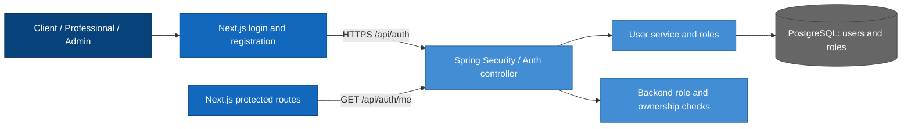
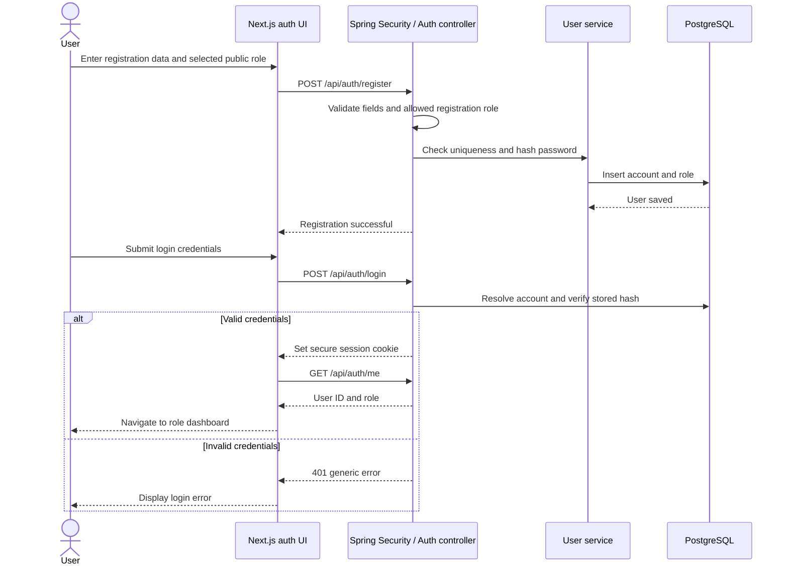
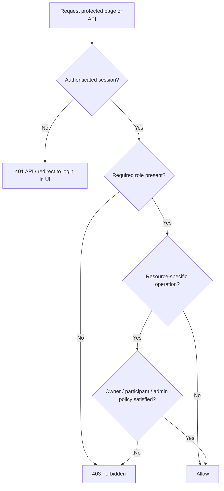

# Authentication and authorization — architecture and implementation plan

**Project:** Intelligent Services Marketplace  
**Status:** Proposed MVP implementation; not a claim of completed functionality.  
**Scope:** Registration, login, logout, session management, role-based authorization, protected frontend routes.  
**Related documents:** [Project proposal](project-proposal.md) · [System context](system-context.md) · [Container diagram](container-diagram.md) · [Backend setup](backend-setup-steps.md) · [Frontend setup](frontend-setup-steps.md) · [Dashboards plan](README-dashboards.md)

## 1. Scope and role contract

Public users may register as `CLIENT` or `PROFESSIONAL`. The `ADMIN` role is assigned only through a controlled administrative process. Authentication is shared by the client, professional and administrator dashboards, the traditional request form, lead purchases, chat and moderation. No other module may rely on frontend-only authorization.

| Action | Who may perform it |
| --- | --- |
| Register as client/professional, log in | Public |
| Log out, fetch own identity | Authenticated user |
| Create request through classic form | `CLIENT` |
| Access professional leads and credits | `PROFESSIONAL`, according to ownership rules |
| Moderate requests/users/disputes | `ADMIN` |

**Open decision:** Session-based secure HttpOnly cookies are recommended for the browser MVP; JWT remains an alternative if selected by the team. Agree on this before implementing the API and WebSocket authentication.

## 2. Logical architecture — C4 Level 3

The components below belong to the existing Next.js application and Spring Boot modular monolith, not standalone services.

Frontend route guards are a usability layer; **the Spring Boot backend remains the authority for every protected operation**.

## 3. Detailed design, diagrams and API

### 3.1 Design

- Store accounts and roles in PostgreSQL; never store plaintext passwords. Use Spring Security's password encoder (for example BCrypt or Argon2, subject to the team's dependency choices).
- Public registration permits `CLIENT` and `PROFESSIONAL` only. The backend, not a form field, decides which roles can be created. `ADMIN` accounts are provisioned through an explicitly controlled process.
- Prefer **server-managed sessions with Secure, HttpOnly, SameSite cookies** for the browser MVP. If the team has already standardized on JWT, use that standard instead; document token expiration, safe storage and revocation before implementation.
- With cookie-based sessions, implement CSRF protection for state-changing requests. Use HTTPS in deployment, restrict CORS/origins and configure cookie attributes appropriately; never put credentials or session secrets in local storage or analytics events.
- Apply route-level role policies and **object ownership rules**. A professional must not open client-only `/api/requests/{id}` merely by guessing an ID.
- Rate-limit login/registration attempts; handle invalid credentials generically; do not log passwords or authentication secrets.
- Keep authentication responses small and avoid exposing password hashes or sensitive contact fields.

### 3.2 Registration and login sequence

### 3.3 Authorization decision flow

### 3.4 Proposed REST API contract

| Method | Endpoint | Behavior | Access |
| --- | --- | --- | --- |
| `POST` | `/api/auth/register` | Register a client or professional | Public |
| `POST` | `/api/auth/login` | Authenticate and start a session | Public |
| `POST` | `/api/auth/logout` | Invalidate session | Authenticated |
| `GET` | `/api/auth/me` | Get current user's ID and role | Authenticated |

Suggested registration input: `email`, `password`, `displayName`, `role`; professionals can complete more extensive profile fields using the existing profile module. Use consistent error formats for `400` validation, `401` unauthenticated, `403` forbidden and `409` duplicate email. Endpoint names are **proposals** and should be agreed before frontend/backend implementation.

### 3.5 Authentication implementation steps

1. Define `User`, roles and profile ownership with the team; avoid duplicating profile tables already owned by another contributor.
2. Add Flyway migrations for missing user-related schema and unique normalized email index. Keep migration numbering coordinated across branches.
3. Configure Spring Security filter chain, password encoding, authorization policies, session and CSRF strategy.
4. Implement registration, login, logout and `/me` with DTO validation and generic failure responses.
5. Implement login/register pages, form errors, loading states and a shared authenticated-user provider or query mechanism.
6. Add protected layouts / route guards for `/client`, `/professional`, and `/admin`; validate roles again in every backend endpoint.
7. Add unit, integration and browser tests for authentication, cross-role access and ownership.

## 4. Dependencies and integration boundaries

- **Dashboards:** expose current authenticated user and role through `/api/auth/me`; the UI must not trust its own role checks to grant API access.
- **Traditional request form:** derive request owner from authenticated principal; never accept a client ID as authority from the browser.
- **Chat:** agree on secure WebSocket handshake authentication and participant authorization with the chat owner.
- **Professional profiles / leads:** coordinate the user ID and role model without duplicating the profile schema.
- **PostHog:** do not emit password, session identifier or email in analytics events; `sign_up_completed` may be a non-sensitive event.

## 5. Proposed schedule (semester weeks 3–14)

| Weeks | Deliverable |
| --- | --- |
| 3–4 | Confirm role model, session strategy, REST DTOs, access matrix and migration ownership |
| 5–6 | User persistence, Spring Security, registration/login/logout/current-user API, frontend pages |
| 7–8 | Protected routes, role redirects, ownership policies, cross-module integration |
| 9–12 | Integration and end-to-end coverage; security and CSRF/session hardening |
| 13–14 | Regression testing, documentation, code review and demo |

## 6. Tests and completion criteria

### Authentication test checklist

- [ ] Client and professional can register and log in; duplicate emails are rejected.
- [ ] Public registration cannot assign `ADMIN` or arbitrary privilege flags.
- [ ] Password hashes are stored securely; password never appears in API responses/logs.
- [ ] Missing authentication produces `401`; wrong role produces `403`.
- [ ] Logout invalidates the active session, and cookie-based mutations respect CSRF policy.
- [ ] Changing a URL or API request manually cannot bypass backend role/ownership rules.

**Definition of done:** A client and professional can register, sign in, refresh the page without losing a valid session, access only their permitted routes and APIs, and log out. Admin privileges cannot be self-assigned. Unauthorized API access is rejected by Spring Security and ownership rules even when frontend checks are bypassed.

**Implementation note:** Endpoint names, input fields and cookie/JWT choice are proposed contracts that require agreement with the team before coding.
