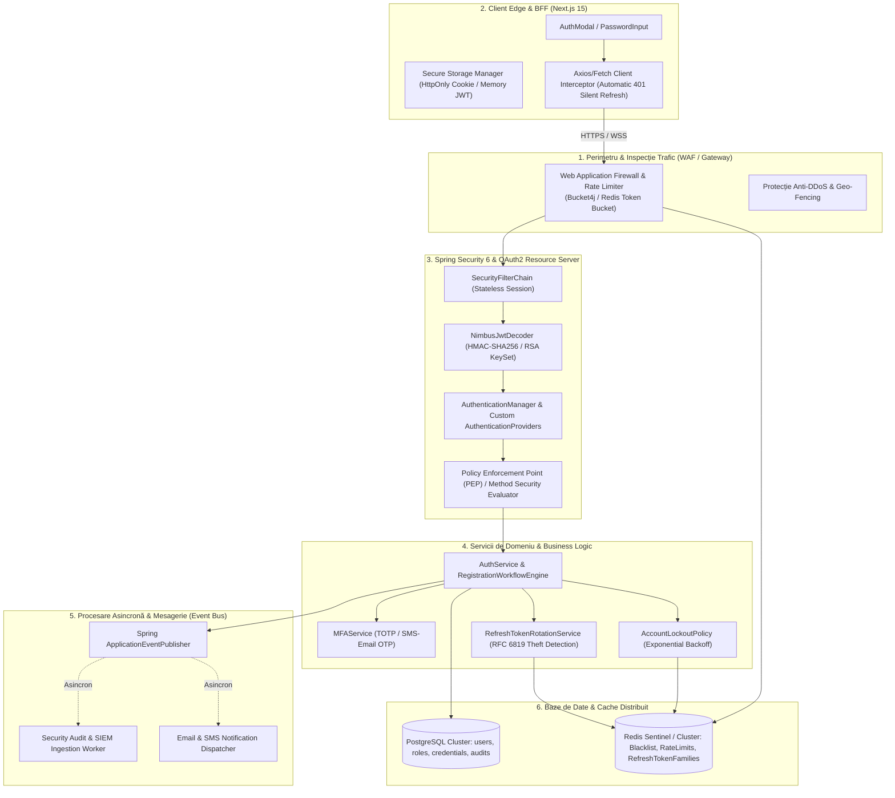
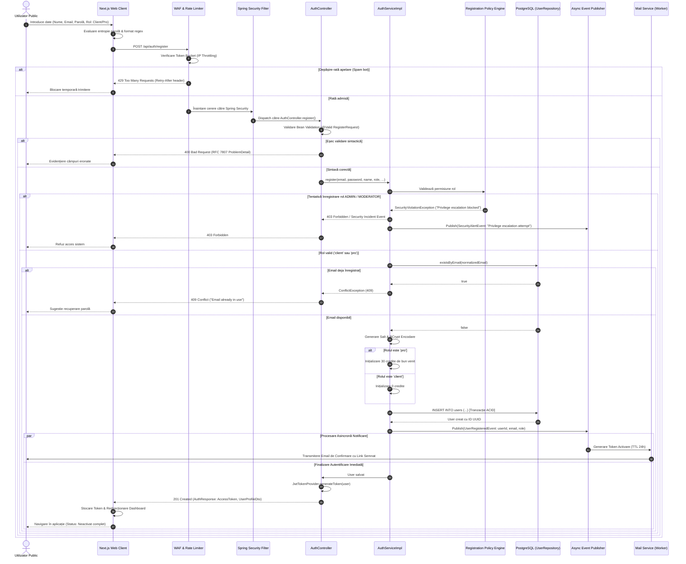
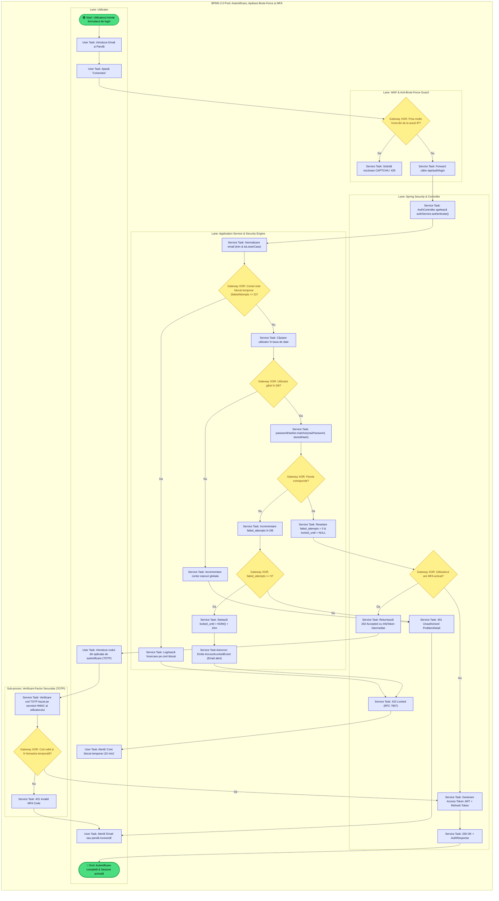
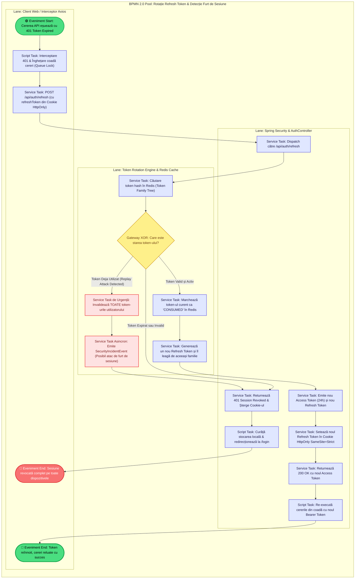
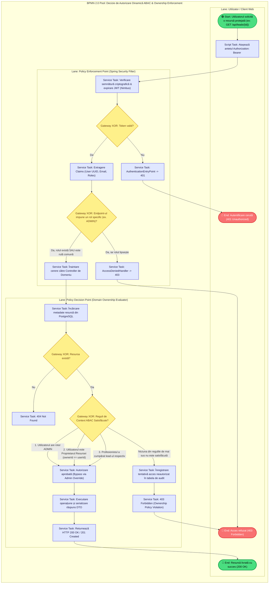

# Arhitectură Avansată și Modelare Formală BPMN 2.0 — Subsistemul de Autentificare, Autorizare și Guvernanță a Securității

**Proiect:** Intelligent Services Marketplace (Skillink)  
**Standard:** ISO/IEC 19510:2013 (BPMN 2.0 — Business Process Model and Notation)  
**Fișier XML BPMN 2.0 Executabil & Vizual:** [`docs/authentication-process.bpmn`](authentication-process.bpmn)  
**Nivel de Maturitate Arhitecturală:** Enterprise / Zero Trust / OAuth 2.1 & OpenID Connect Compliant

---

## 1. Topologia Arhitecturală Globală și Modelul de Încredere (Zero Trust)

Sistemul de securitate este proiectat pe principii **Zero Trust** (Defense-in-Depth), decuplând perimetrul public de logica de domeniu prin multiple straturi de validare, atenuare a riscurilor și auditare.

---

## 2. Diagrame BPMN 2.0 Complexe și Culoare (Enterprise Swimlanes)

### 2.1 Procesul 1: Înregistrare Publică, Detecție Escaladare Privilegii, Activare Tranzacțională și Onboarding

Acest proces modelează ciclul complet de înregistrare, izolarea rolurilor privilegiate, hashing-ul BCrypt cu verificare de entropie, acordarea creditelor de bun venit și inițierea verificării asincrone a adresei de email cu eveniment de graniță temporizat (Timer Boundary Event).

#### Diagrama de Flux BPMN (Swimlane Flowchart) — Înregistrare Avansată

```mermaid
flowchart TD
    subgraph Pool_Advanced_Register ["BPMN 2.0 Pool: Proces Înregistrare Cont și Prevenire Escaladare Privilegii"]
        direction TB

        subgraph Lane_User_Reg ["Lane: Utilizator Public"]
            Start_R(["🟢 Eveniment Start: Utilizatorul dorește să se înregistreze"]) --> Task_Input_R["User Task: Completează formularul și selectează rolul"]
            Task_Input_R --> Task_Submit_R["User Task: Trimite datele către platformă"]
            Show_429_R["User Task: Primește alerta 'Prea multe cereri'"]
            Show_Validation_Err["User Task: Corectează erorile din formular"]
            Show_Escalation_Err["User Task: Notificare 'Operațiune interzisă'"]
            Show_Conflict_Err["User Task: Notificare 'Adresă de email deja utilizată'"]
            Reg_Complete_End(["🏁 Eveniment End: Cont creat, sesiune inițiată"])
        end

        subgraph Lane_Edge_WAF ["Lane: WAF & Rate Limiter (Edge Gateway)"]
            Task_Submit_R --> WAF_Bucket_Check{"Gateway XOR: Limită apelare per IP depășită?"}
            WAF_Bucket_Check -- Da --> WAF_Throw_429["Service Task: Returnează HTTP 429 Too Many Requests"]
            WAF_Throw_429 --> Show_429_R
            WAF_Bucket_Check -- Nu --> Forward_To_Spring["Service Task: Forward către API Gateway"]
        end

        subgraph Lane_Controller_Reg ["Lane: Spring Security & AuthController"]
            Forward_To_Spring --> DTO_Val_Check{"Gateway XOR: Validare Jakarta DTO validă?"}
            DTO_Val_Check -- Nu --> Return_400_R["Service Task: Returnează 400 Bad Request (RFC 7807)"]
            Return_400_R --> Show_Validation_Err
            DTO_Val_Check -- Da --> Invoke_Auth_Svc["Service Task: Invocă AuthService.register()"]
            Return_403_Sec["Service Task: Returnează 403 Forbidden"] --> Show_Escalation_Err
            Return_409_Sec["Service Task: Returnează 409 Conflict"] --> Show_Conflict_Err
            Issue_JWT_Pair["Service Task: JwtTokenProvider generează Access Token (24h)"] --> Return_201_Sec["Service Task: Returnează HTTP 201 Created cu AuthResponse"]
        end

        subgraph Lane_Application_Reg ["Lane: Application Service & Domain Model"]
            Invoke_Auth_Svc --> Role_Security_Check{"Gateway XOR: Rolul solicitat este 'client' sau 'pro'?"}
            Role_Security_Check -- Nu (admin/arbitrar) --> Log_Audit_Incident["Service Task: Înregistrare incident securitate"]
            Log_Audit_Incident --> Return_403_Sec
            Role_Security_Check -- Da --> Check_Email_Uniq["Service Task: Verificare unicitate email normalizat"]
            Check_Email_Uniq --> Email_Exists_Check{"Gateway XOR: Email deja existent?"}
            Email_Exists_Check -- Da --> Return_409_Sec
            Email_Exists_Check -- Nu --> BCrypt_Hash_Task["Service Task: Generare Salt & Encodare BCrypt"]
            BCrypt_Hash_Task --> Role_Pro_Check{"Gateway XOR: Este rolul 'pro'?"}
            Role_Pro_Check -- Da --> Set_30_Bonus["Service Task: Setează creditsBalance = 30"]
            Role_Pro_Check -- Nu --> Set_0_Bonus["Service Task: Setează creditsBalance = 0"]
            Set_30_Bonus --> Exec_Tx_Save["Service Task Tranzacțional: Salvare entitate User în baza de date"]
            Set_0_Bonus --> Exec_Tx_Save
            Exec_Tx_Save --> Parallel_Post_Reg{{"Gateway Paralel (AND): Declanșare procese paralele"}}
            Parallel_Post_Reg --> Issue_JWT_Pair
            Parallel_Post_Reg --> Publish_User_Event["Service Task Asincron: Emite UserRegisteredEvent"]
        end

        subgraph Lane_Notification_Reg ["Lane: Sistem Notificări Asincrone (Worker)"]
            Publish_User_Event --> Gen_Activation_Link["Service Task: Generează link activare semnat (HMAC, TTL 24h)"]
            Gen_Activation_Link --> Send_Activation_Email["Service Task: Expediază email prin SMTP Gateway"]
            Send_Activation_Email --> Email_Sent_End(["🏁 Eveniment End: Email activare expediat"])
        end

        subgraph Lane_UI_Store ["Lane: Next.js Frontend Client"]
            Return_201_Sec --> Save_Session_Storage["Script Task: Salvare token în localStorage & emitere AuthContext"]
            Save_Session_Storage --> Reg_Complete_End
        end
    end

    classDef startEvent fill:#4ade80,stroke:#16a34a,stroke-width:2px,color:#000
    classDef endEvent fill:#4ade80,stroke:#16a34a,stroke-width:3px,color:#000
    classDef task fill:#e0e7ff,stroke:#4f46e5,stroke-width:1.5px,color:#1e1b4b
    classDef gateway fill:#fef08a,stroke:#ca8a04,stroke-width:1.5px,color:#713f12
    classDef parallel fill:#fed7aa,stroke:#ea580c,stroke-width:2px,color:#7c2d12

    class Start_R,Email_Sent_End startEvent
    class Reg_Complete_End endEvent
    class WAF_Bucket_Check,DTO_Val_Check,Role_Security_Check,Email_Exists_Check,Role_Pro_Check gateway
    class Parallel_Post_Reg parallel
    class Task_Input_R,Task_Submit_R,WAF_Throw_429,Forward_To_Spring,Return_400_R,Invoke_Auth_Svc,Return_403_Sec,Return_409_Sec,Issue_JWT_Pair,Return_201_Sec,Log_Audit_Incident,Check_Email_Uniq,BCrypt_Hash_Task,Set_30_Bonus,Set_0_Bonus,Exec_Tx_Save,Publish_User_Event,Gen_Activation_Link,Send_Activation_Email,Save_Session_Storage,Show_429_R,Show_Validation_Err,Show_Escalation_Err,Show_Conflict_Err task
```

---

### 2.2 Procesul 2: Autentificare Avansată, Apărare Anti-Brute-Force, Blocare Cont și MFA / 2FA

Acest proces detaliază mecanismele de apărare împotriva atacurilor de tip dicționar/credential stuffing:
1. Verificare cont blocat (Account Lockout Policy cu backoff exponențial);
2. Verificare credențiale BCrypt;
3. Incrementare contor eșecuri la parolă greșită și declanșare automată a blocării contului;
4. Sub-proces de verificare a factorului secundar (TOTP / OTP prin email/SMS);
5. Resetare contor eșecuri și emiterea perechii de jetoane (Access Token + Refresh Token cu familie protejată).

---

### 2.3 Procesul 3: Rotația Token-urilor de Reîmprospătare (RTR) și Detecția Furtului de Sesiune (RFC 6819)

Mecanismul de **Refresh Token Rotation (RTR)** garantează că fiecare `RefreshToken` poate fi utilizat o singură dată. Dacă un token deja consumat este prezentat din nou (simptom specific interceptării / furtului token-ului), sistemul invalidează automat **întreaga familie de token-uri** asociată utilizatorului și forțează deconectarea pe toate dispozitivele.

---

### 2.4 Procesul 4: Control Dinamic al Accesului Bazat pe Atribute (ABAC) și Politică de Proprietate (Ownership PEP/PDP)

Acest proces modelează Policy Enforcement Point (PEP) și Policy Decision Point (PDP) la accesarea oricărei resurse securizate din platformă (de exemplu: descărcarea detaliilor unui lead cumpărat, modificarea profilului sau accesarea camerei de chat protejate).

---

## 3. Matricea Completă de Mapare a Elementelor BPMN 2.0 la Nivel de Cod Sursă

| Simbol / ID BPMN 2.0 | Tip Element Standard | Componentă în Proiect | Semnătură / Implementare Concretă |
| :--- | :--- | :--- | :--- |
| **`WAF_Bucket_Check`** | Service Task / Gateway | Gateway Edge / WAF | Algoritm Token Bucket (ex. 10 req/s, burst 20). |
| **`DTO_Val_Check`** | Exclusive Gateway (XOR) | [`ro.marketplace.app.dto.AuthDtos`](file:///Users/theo/Documents/ingineria-programarii-2/backend/marketplace-app/src/main/java/ro/marketplace/app/dto/AuthDtos.java) | `@NotBlank`, `@Email`, `@Size(min = 6)` pe `RegisterRequest`. |
| **`Role_Security_Check`** | Exclusive Gateway (XOR) | [`AuthServiceImpl.java:53-56`](file:///Users/theo/Documents/ingineria-programarii-2/backend/marketplace-application/src/main/java/ro/marketplace/application/service/AuthServiceImpl.java#L53-L56) | Verificare strictă: dacă `!role.equals("client") && !role.equals("pro")` -> aruncă `ValidationException`. |
| **`Check_Account_Locked`** | Exclusive Gateway (XOR) | Serviciu Securitate / Redis | Verificare `locked_until > NOW()` pentru prevenirea atacurilor brute-force. |
| **`BCrypt_Hash_Task`** | Service Task | [`SecurityConfig.java:83-85`](file:///Users/theo/Documents/ingineria-programarii-2/backend/marketplace-app/src/main/java/ro/marketplace/app/security/SecurityConfig.java#L83-L85) | `new BCryptPasswordEncoder(12)` — hashing cu funcție lentă și salt. |
| **`Role_Pro_Check`** | Exclusive Gateway (XOR) | [`AuthServiceImpl.java:74`](file:///Users/theo/Documents/ingineria-programarii-2/backend/marketplace-application/src/main/java/ro/marketplace/application/service/AuthServiceImpl.java#L74) | `.creditsBalance(ROLE_PRO.equals(normalizedRole) ? 30 : 0)`. |
| **`Exec_Tx_Save`** | Transactional Service Task | [`AuthServiceImpl.java:58-83`](file:///Users/theo/Documents/ingineria-programarii-2/backend/marketplace-application/src/main/java/ro/marketplace/application/service/AuthServiceImpl.java#L58-L83) | `unitOfWork.executeInTransaction(() -> userRepository.save(newUser))`. |
| **`Issue_JWT_Pair`** | Service Task | [`JwtTokenProvider.java:39-66`](file:///Users/theo/Documents/ingineria-programarii-2/backend/marketplace-app/src/main/java/ro/marketplace/app/security/JwtTokenProvider.java#L39-L66) | Semnare HMAC-SHA256 cu `subject(userId)`, `roles`, `validity=24h`. |
| **`Token_State_Check`** | Event-driven Gateway | Refresh Token Rotation Engine | Detecție Replay Attack conform RFC 6819; revocare cascadă familie de jetoane. |
| **`Validate_Signature`** | Service Task | [`SecurityConfig.java:108-115`](file:///Users/theo/Documents/ingineria-programarii-2/backend/marketplace-app/src/main/java/ro/marketplace/app/security/SecurityConfig.java#L108-L115) | `NimbusJwtDecoder.withSecretKey(key).macAlgorithm(MacAlgorithm.HS256).build()`. |
| **`RBAC_Route_Check`** | Exclusive Gateway (XOR) | [`SecurityConfig.java:65-73`](file:///Users/theo/Documents/ingineria-programarii-2/backend/marketplace-app/src/main/java/ro/marketplace/app/security/SecurityConfig.java#L65-L73) | `.requestMatchers("/api/audit/**").hasRole("ADMIN")`. |
| **`Evaluate_ABAC_Rules`** | Complex Decision Gateway | Domain Service / Method Security | Evaluare proprietate resursă (`ownerId == authenticatedUser.id()`). |
| **`Intercept_401_Task`** | Catch Event / Script Task | [`apiClient.ts:61-67`](file:///Users/theo/Documents/ingineria-programarii-2/frontend/services/api/apiClient.ts#L61-L67) | Interceptare automată răspuns 401 și emisie eveniment browser `auth:unauthorized`. |
| **`Publish_User_Event`** | Intermediate Message Throw | Spring Event Bus | `ApplicationEventPublisher.publishEvent(new UserRegisteredEvent(...))`. |

---

## 4. Analiză de Amenințări și Vectori de Atac Mitigați (Threat Modeling STRIDE)

| Amenințare (STRIDE) | Vector de Atac Specific | Mecanism de Atenuare Modelat în BPMN |
| :--- | :--- | :--- |
| **Spoofing Identity** | Furt de token JWT și reluare (Replay Attack) | **RTR (Refresh Token Rotation)** cu invalidare totală a familiei de token-uri la reutilizare suspectă. |
| **Tampering with Data** | Falsificare privilegii în payload-ul JWT (ex: `roles: ["ADMIN"]`) | Semnătură criptografică HMAC-SHA256 / RSA validată la fiecare cerere de [`NimbusJwtDecoder`](file:///Users/theo/Documents/ingineria-programarii-2/backend/marketplace-app/src/main/java/ro/marketplace/app/security/SecurityConfig.java#L108-L115). |
| **Repudiation** | Negarea executării unei tranzacții sau a unei acțiuni de moderare | Evenimente asincrone de audit (`SecurityIncidentEvent`) persistate imutabil în tabela `audit_logs`. |
| **Information Disclosure**| Expunerea hash-urilor de parolă sau a cheilor în răspunsuri | DTO-uri strict izolate ([`UserProfileDto`](file:///Users/theo/Documents/ingineria-programarii-2/backend/marketplace-app/src/main/java/ro/marketplace/app/dto/AuthDtos.java#L46-L70)) care nu includ niciodată câmpul `password_hash`. |
| **Denial of Service (DoS)** | Atac brute-force pe `/api/auth/login` și epuizare conexiuni DB | Rate Limiter bazat pe Token Bucket (Edge WAF) + Account Lockout exponențial după 5 încercări eșuate. |
| **Elevation of Privilege**| Trimiterea `role: "admin"` în corpul cererii de înregistrare | Constrângere forțată la nivel de serviciu de domeniu în [`AuthServiceImpl.java:54`](file:///Users/theo/Documents/ingineria-programarii-2/backend/marketplace-application/src/main/java/ro/marketplace/application/service/AuthServiceImpl.java#L54). |
