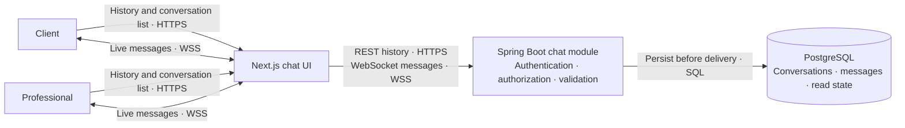
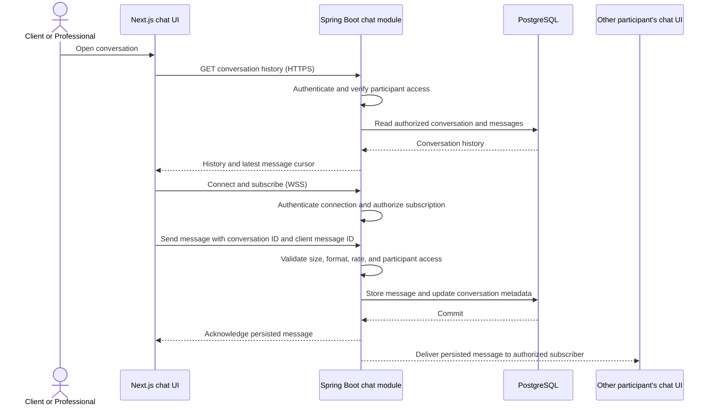

# Chat — architecture and implementation plan

Status: proposed implementation plan for the MVP real-time chat described in the [project proposal](project-proposal.md). Chat is in semester scope; this document describes intended behavior, not implemented functionality.

## Scope and access rule

Clients and professionals may communicate after they are connected through an eligible lead. The backend must authorize every history request, WebSocket connection, subscription, and message against the conversation participants. A proposed starting rule is one conversation per purchased lead, between the request owner and the professional who purchased that lead. Confirm this rule with the team before schema design.

Messages are persisted in PostgreSQL and delivered over an authenticated WebSocket connection. The REST API remains the source for loading history and conversation summaries; reconnecting clients recover missed messages from persisted history. Chat must not expose client contact details unless the existing lead-purchase rules authorize them. Message content and contact information must not be sent to PostHog.

## Logical architecture

These modules belong to the existing Next.js application and Spring Boot modular monolith; they are not separate services.

The diagram abstracts the WebSocket protocol. Select plain WebSocket or a messaging subprotocol such as STOMP during implementation based on the Spring and frontend setup. The existing Next.js API rewrite does not configure WebSocket upgrades; local development and deployment routing need an explicit WSS path.

## Message flow

The server acknowledges a message only after its database transaction commits. If live delivery is unavailable, the message remains available through history after reconnect. A client-generated message ID can make retries idempotent and prevent duplicate messages after transient disconnects.

## Implementation plan

1. **Confirm the contract.** Agree on conversation creation (recommended: after lead purchase), participant rules, retention, message limits, read state, and notification behavior. Define REST and WebSocket payloads, pagination/cursors, error responses, and reconnect behavior.
2. **Build the persistence model.** Add Flyway migrations and JPA models for conversations and messages, plus participant and last-activity references. Add uniqueness constraints for the chosen conversation-per-lead rule and for sender-scoped idempotency keys. Store timestamps in UTC.
3. **Implement backend authorization and history.** Add conversation listing and paginated history endpoints. Reuse the authenticated principal and lead/request relationships; deny access by default and test direct-ID access by nonparticipants.
4. **Implement authenticated real-time delivery.** Configure Spring WebSocket and WSS routing. Authenticate the handshake using the application's established mechanism, restrict allowed origins, authorize subscriptions and sends per conversation, validate payloads, apply size/rate limits, persist before fan-out, and return acknowledgements/errors.
5. **Build the chat experience.** Add conversation list, history loading, message composition, delivery/error state, reconnect handling, and new-message indicators in the professional and client interfaces. Use REST history to recover messages missed while disconnected.
6. **Integrate and harden.** Add end-to-end coverage for an authorized lead conversation, test simultaneous users and reconnects, document local routing, and verify logs/analytics do not contain message bodies or contact data.

### Completion checks

- Only the request owner and authorized lead professional can list, read, subscribe to, or send messages in a conversation.
- A message is durable before the sender receives success; a duplicate retry does not create a second message.
- Reconnecting and loading history recovers committed messages without relying on in-memory server state.
- WebSocket routing works in local and deployment configurations, and unauthorized origins or subscriptions are rejected.
- Tests cover access denial, validation, persistence, ordering/cursors, retry behavior, and the end-to-end client/professional conversation.