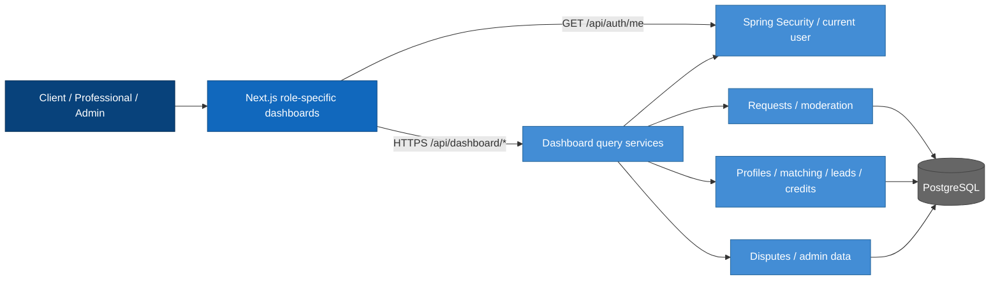
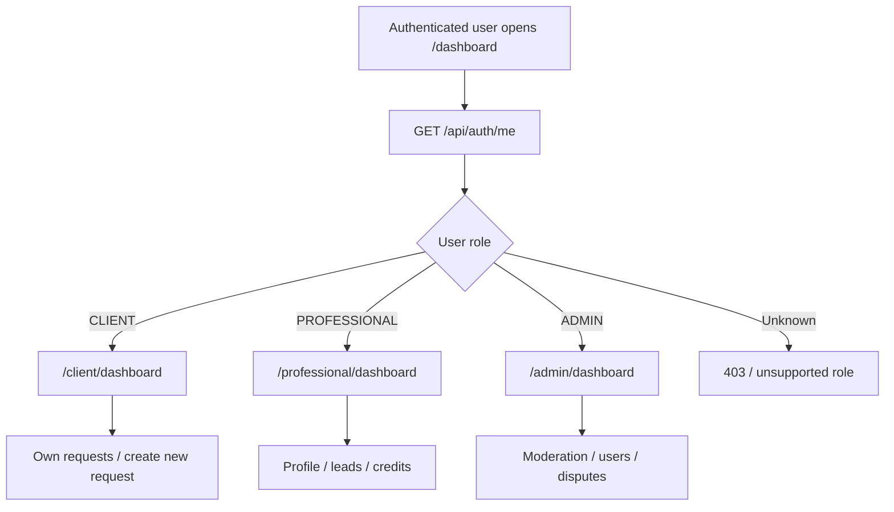
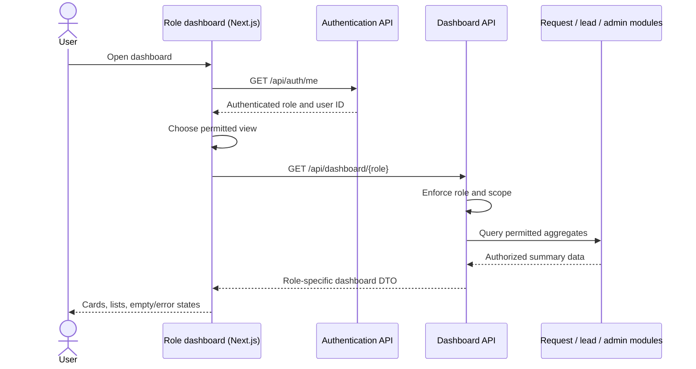

# Role-based dashboards — architecture and implementation plan

**Project:** Intelligent Services Marketplace  
**Status:** Proposed MVP implementation; not a claim of completed functionality.  
**Scope:** Responsive dashboards for `CLIENT`, `PROFESSIONAL` and `ADMIN`, with backend-authorized summaries and navigation.  

## 1. Scope and role-based screens

The platform uses a single **Next.js / React / TypeScript** frontend and a **Spring Boot** modular backend. Dashboard content is derived from existing user, request, matching, lead, credit and dispute modules rather than storing duplicated dashboard business data.

| Role | Main widgets/actions | Access |
| --- | --- | --- |
| `CLIENT` | Own requests, counts by status, recent requests, **Create request** | Own requests only |
| `PROFESSIONAL` | Profile completeness, eligible opportunities, purchased leads, credit summary (as available) | Only own profile and permitted leads |
| `ADMIN` | Platform KPIs, moderation queue, navigation to user/dispute administration | Admin only |

If an upstream module is not implemented, show an explicit unavailable/empty state instead of invented statistics. The traditional request form is documented and implemented separately; the client dashboard links to it.

## 2. Logical architecture — C4 Level 3

Dashboards are views of data from existing domain modules, not independent business systems.

The backend filters records and enforces role permissions before computing summaries. The dashboard should not expose personal contact details merely because a record appears in an aggregate.

## 3. Dashboard behavior, diagrams and implementation

Dashboards are **role-specific projections**, not alternate sources of truth. Each loads its summaries from authorized backend APIs and links to domain modules owned by the relevant team members.

| Dashboard | Initial components | Dependencies |
| --- | --- | --- |
| **Client** | Welcome header; count of own requests by status; recent requests; “Create request” action; conversation shortcut if available | Auth + request service; optional chat |
| **Professional** | Profile completion; opportunity/lead summary; purchased lead list; balance as returned by credit module; conversation shortcut | Auth + professional profile, matching, lead/credit modules |
| **Admin** | Overview metrics; pending moderation queue; links to users and disputes; recent critical activity if available | Auth + request moderation, user administration, disputes |

Do not fabricate numerical summaries: show a defined loading/empty state or `Unavailable` if the corresponding backend module is not ready. Dashboard data must be filtered at the backend, not by downloading all records and filtering in the browser.

### 4.1 Dashboard navigation

### 4.2 Data loading sequence

### 4.3 Dashboard implementation steps

1. Define the summary DTO per role, including field meanings and authorized data sources.
2. Build reusable layout components: navigation, sidebar/header, status badges, summary cards, lists, empty/loading/error states and responsive breakpoints.
3. Implement the client dashboard first, consuming the request module's own-list endpoint.
4. Implement professional dashboard with placeholder-free integrations as lead and credit endpoints become available; keep unimplemented features visibly unavailable.
5. Implement admin dashboard and moderation queue through admin-only backend endpoints; never use a shared unfiltered user endpoint.
6. Test desktop/mobile layout, deep links, reloads, unauthenticated redirects, cross-role denial and query failures.

**Proposed endpoints:** `GET /api/dashboard/client`, `GET /api/dashboard/professional`, `GET /api/dashboard/admin`. Alternatively, the team may decide to compose dashboards from existing domain endpoints; avoid adding both patterns without reason.

## 4. Role-specific authorization and data contracts

| Endpoint (proposed) | Role | Output and source |
| --- | --- | --- |
| `GET /api/dashboard/client` | `CLIENT` | Counts and recent requests owned by current client from request module |
| `GET /api/dashboard/professional` | `PROFESSIONAL` | Profile status, eligible/purchased leads and credit balance from owning modules |
| `GET /api/dashboard/admin` | `ADMIN` | Platform KPIs, pending moderation and relevant dispute summaries |

Use DTOs that reveal only permitted fields. The backend scopes `CLIENT` and `PROFESSIONAL` queries using authenticated user identity rather than a supplied user ID. Exact endpoint structure is subject to agreement; existing domain APIs may be composed instead.

## 5. Data and component integration

1. Reuse `/api/auth/me` to resolve the active identity/role and redirect from `/dashboard` to the appropriate view.
2. Connect the **client** dashboard to the requests module. Own request list and status are prerequisites for an end-to-end classic-form journey.
3. Connect the **professional** dashboard to professional profiles, matching, paid leads and credit balances through the modules owned by colleagues; never implement lead charging in the dashboard.
4. Connect the **admin** dashboard to request moderation, user administration and dispute services. Backend admin authorization is mandatory for the queries and actions.
5. Show loading, empty, error, permission-denied and unavailable states. Ensure responsive navigation on desktop/mobile.
6. Track coarse, non-sensitive `dashboard_viewed` analytics only; do not send contact details or sensitive request text.

## 6. Proposed schedule (semester weeks 3–14)

| Weeks | Deliverable |
| --- | --- |
| 3–4 | Dashboard wireframes, route matrix, role-scoped DTOs and upstream module contracts |
| 5–6 | Shared responsive layout, authentication integration and client dashboard |
| 7–8 | Professional dashboard integrated with completed profile/lead/credit APIs |
| 9–10 | Admin dashboard, moderation links and authorized KPIs |
| 11–12 | Integration with request workflow, empty/error handling and E2E tests |
| 13–14 | Responsiveness, authorization regression tests, documentation and demonstration |

## 7. Tests and completion criteria

### Dashboard test checklist

- [ ] Each role lands on the correct dashboard and cannot retrieve another role's protected dashboard API.
- [ ] Client summaries and request lists are restricted to the authenticated client.
- [ ] Professional overview uses authorized lead/credit data supplied by the corresponding modules.
- [ ] Admin moderation metrics and actions are unavailable to non-admin users.
- [ ] Empty, loading and backend-error states are usable; layout works on mobile and desktop.

**Acceptance walkthrough:** A client signs in, opens the client dashboard and sees only their requests, including one submitted through the traditional form. A professional sees only their own permitted opportunities/lead data. An administrator sees the moderation overview. Each role receives `403` for other roles' protected endpoints. The interface works on mobile and desktop, including empty and failed-request states.

**Implementation note:** This file describes dashboard implementation only. Authentication and the traditional request form remain separate workstreams with their own backend contracts.
