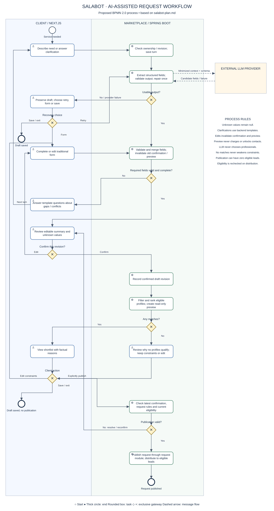

# Salabot BPMN workflow

This diagram describes the **proposed** AI workflow from [the Salabot implementation plan](salabot-plan.md), rather than claiming the workflow is already implemented.

- [Open the SVG diagram](diagrams/salabot-workflow.svg).
- [Download the editable BPMN 2.0 model](diagrams/salabot-workflow.bpmn) for a BPMN modeler.

The process covers structured extraction, backend validation, clarification, traditional-form fallback, revision confirmation, deterministic matching, and explicit publication. The client and backend are lanes in the marketplace process; the external LLM is a separate participant connected by message flows. Exclusive gateways select one path.

The extraction task abstracts provider timeouts, bounded retries, parsing, and at most one output-repair attempt. Failure preserves the existing draft. Form edits pass through the same backend validation and invalidate previous confirmation and previews. Ownership, revision checks, and idempotency apply across backend operations.

A no-match preview lets the client edit constraints, save, or explicitly attempt publication; ordinary request-module rules still decide whether publication is allowed. The diagram assumes an otherwise valid request may be published with no currently eligible professionals, in which case no lead is distributed. This policy should be confirmed during implementation. Lead purchases, credit debits, and contact unlocking are outside this process.

The `.bpmn` file includes diagram coordinates and is a documentation model (`isExecutable="false"`), not an engine deployment artifact.
