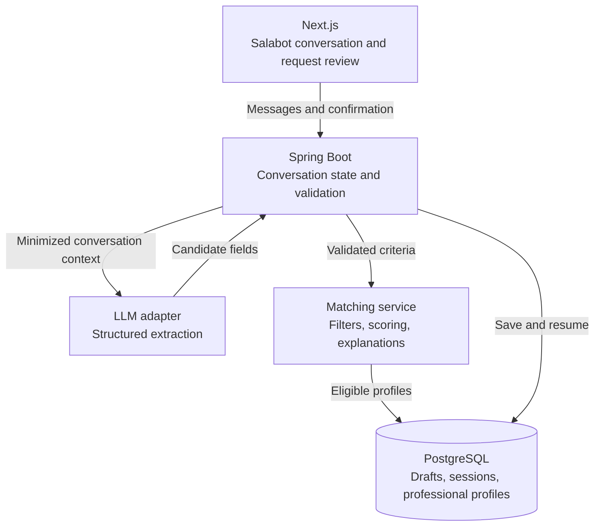

# Salabot — robotul nostru salahor

Status: proposed implementation plan, aligned with sections 5 and 6 of the [project proposal](project-proposal.md). This plan does not change the agreed semester scope.

Salabot helps a client describe the service they need, clarifies missing information, and prepares a request that the marketplace can match to eligible professionals. The LLM interprets language; Spring Boot validates the request and computes the matches.

## 1. First-version scope

Start with three categories: roof repair, interior painting, and website development. These cover on-site work and remote services without requiring a complete taxonomy for every trade.

Aim for two or three clarification rounds for ordinary requests. This is a usability target, not a rule that forces Salabot to recommend someone before it has enough information. Each round should ask one or two related questions. Clients can answer “I don't know,” edit their answers, or switch to the traditional form.

The first version supports Romanian conversations, structured request extraction, client confirmation, deterministic matching, and factual match explanations. It excludes autonomous hiring, purchases, refunds, external browsing, model training, semantic ranking, and long-term personal memory.

## 2. Client journey

1. The client describes the problem: “Vreau să schimb țigla de pe casă.”
2. Salabot asks the most useful missing questions: locality, approximate roof area, repair versus replacement, materials included, budget, and desired timing.
3. The backend validates each extracted field and identifies remaining gaps or conflicts.
4. The client sees an editable summary, including unknown values, and confirms it.
5. The backend computes eligible professionals and returns an initial shortlist with reasons. If none qualify, it explains which constraints prevented a match and asks whether the client wants to change them.
6. The client explicitly publishes the confirmed request. The marketplace validates and distributes the lead using its normal workflow.

Matching previews are read-only and do not publish requests, unlock contact details, or debit credits. Professionals still purchase eligible leads to contact clients, as defined in the proposal. Revalidate eligibility when distributing a lead because profiles and availability may change after a preview.

## 3. Architecture



These are logical modules inside the existing Spring Boot backend, except for the frontend, database, and model provider. They are not separate microservices.

Proposed backend responsibilities:

| Module | Responsibility |
| --- | --- |
| `matching` | Shared deterministic eligibility, ranking, and reason codes for both forms and Salabot. |
| `salabot` | Conversation ownership, turn handling, extraction, clarification, draft revisions, and preview orchestration. |
| `salabot.llm` | Provider adapter, prompt and schema versions, timeouts, bounded retries, and response parsing. |
| Existing request module | Confirmed request persistence, publication, and lifecycle. |
| Existing lead and credit modules | Lead distribution, purchases, contact unlocking, and refunds. |

## 4. Define the data contract before prompting

Professional profiles need structured data alongside their CVs and project descriptions:

- Supported category and service IDs.
- Geographic coverage and remote-service support.
- Category-specific capabilities, such as roof replacement or e-commerce development.
- Availability, including when it was last confirmed.
- Optional price ranges with currency, unit, and scope: per project, per square metre, or per hour.
- Portfolio descriptions and a defined profile-completeness measure.

Do not compare an hourly rate with a total project budget. Budget compatibility is unknown unless the amounts have comparable units and scope. Profile completeness must not be presented as verified work quality.

Use one request schema for the traditional form and Salabot. An illustrative draft is:

```json
{
  "categoryId": "roofing",
  "serviceIds": ["roof_tile_replacement"],
  "description": "Înlocuirea țiglei de pe acoperișul casei",
  "location": {
    "localityId": null,
    "localityText": "Iași"
  },
  "workMode": "onsite",
  "budget": {
    "min": null,
    "max": null,
    "currency": "RON",
    "basis": "project",
    "scope": null
  },
  "desiredStartDate": null,
  "deadline": null,
  "details": {
    "areaSquareMetres": null,
    "materialsIncluded": null
  }
}
```

IDs above are examples; use IDs from the application catalog. The backend resolves locality text to a known locality, and asks for clarification if ambiguous. Category-specific detail schemas constrain allowed keys and types. Validate dates relative to an explicit conversation date and timezone; ask when phrases such as “next Friday” are ambiguous.

Missing values stay `null`. An unmentioned capability is unknown, not automatically false. Keep field evidence separately: source message ID and exact supporting text, plus whether a value was user-provided, inferred, or confirmed. Evidence supports review but does not by itself prove an extraction correct.

For the initial version, preview requires a known category, a meaningful description, and a locality for on-site services. Each category defines any additional required fields. Budget and timing can remain unknown unless the client makes them mandatory constraints.

## 5. Build and validate deterministic matching first

Use database filtering followed by an explicit weighted score. A complex recommendation algorithm is unnecessary for the first dataset.

Hard filters:

- Profile is active and eligible for leads.
- Professional offers the required category and mandatory capabilities.
- Geographic coverage includes the locality, or the service supports remote delivery.
- Any client-confirmed mandatory timing or budget constraint is satisfied by comparable, known profile data.

For mandatory constraints, unknown professional data does not prove compatibility. Exclude the profile from confirmed matches or show it separately as requiring verification. Never silently weaken constraints to produce results.

For eligible profiles, start with this proposed score:

| Signal | Weight |
| --- | --- |
| Coverage of additional requested services | 50% |
| Comparable budget fit | 20% |
| Preferred timing fit | 20% |
| Profile completeness | 10% |

Define each signal on a 0–1 scale with documented rules before implementation. Calculate over applicable signals with available comparable data, and return evidence coverage alongside the score. Unknown data earns no claim of compatibility; low-coverage results should be visibly marked. Treat weights as a hypothesis to evaluate, not established product truth.

Use a stable professional ID as the final tie-breaker. Store the scoring version and evaluate against a fixed profile snapshot: identical criteria, data, and rules must yield identical ordering.

Return professional IDs and factual reason codes such as `SERVICE_SUPPORTED` and `AREA_COVERED`. Render explanations from templates. Do not ask the LLM to invent reasons or select a different ordering. A score is a ranking aid, not a probability of a successful contract.

## 6. Add conversational extraction

On each turn, send the model the relevant conversation, current draft, allowed category/service definitions, extraction schema, and missing-field list. Do not send the full professional catalog, CVs, contact details, or unrelated conversations.

Require structured output, parse it into typed objects, then validate catalog IDs, value ranges, field relationships, evidence, and authorization in Java. Schema-valid output can still misunderstand what the client meant.

Begin with structured extraction rather than a general agent loop. The backend merges validated changes, computes missing fields, and selects the next clarification from category templates. Corrections replace earlier draft values and invalidate confirmation of the changed draft. Preserve explicit uncertainty and ask about contradictions.

If tool calling is added, expose a small read-only tool such as `preview_matches(criteria)`. A tool call is a model-generated request to execute a function; the backend still validates the arguments, authorizes access, and decides whether to execute it. Never expose arbitrary SQL or credit-changing operations to the model.

Low temperature may reduce variation but does not guarantee deterministic extraction. Determinism belongs in the matching service, not in an assumption about repeated LLM responses.

## 7. Minimal conversation workflow

Use an explicit backend state machine:

```text
COLLECTING → REVIEW → CONFIRMED → PREVIEWED → PUBLISHED
```

Clients can return to editing from review or preview. Any edit invalidates the confirmed revision and previous preview. Publication requires the latest client-confirmed revision and the normal request validation rules.

Store session owner, messages, draft revision, confirmation revision, timestamps, and model/prompt/schema versions in PostgreSQL. Limit context size and apply an agreed retention policy. Reject stale concurrent updates and duplicate message submissions using revision checks and idempotency keys.

Start with ordinary HTTP request/response calls; streaming can follow later. Suggested API contracts:

| Endpoint | Purpose |
| --- | --- |
| `POST /api/salabot/sessions` | Create an authenticated client session. |
| `POST /api/salabot/sessions/{id}/messages` | Submit a turn and return the updated draft or clarification. |
| `GET /api/salabot/sessions/{id}` | Resume an owned conversation. |
| `POST /api/salabot/sessions/{id}/confirm` | Confirm a specific draft revision. |
| `POST /api/salabot/sessions/{id}/preview` | Compute read-only matches for that revision. |

Publication should reuse the request module rather than duplicate its business logic in Salabot. Check session ownership on every operation.

## 8. Model hosting and suggested tools

| Option | Plan |
| --- | --- |
| Fireworks-hosted model | First cloud candidate. Evaluate a model that supports the required structured output or tool interface; keep API credentials on the backend. Fireworks documents [tool calling](https://docs.fireworks.ai/guides/function-calling). |
| Local model through LM Studio | Optional experiment using the same evaluation dataset. LM Studio exposes [local HTTP APIs](https://lmstudio.ai/docs/developer/core/server). Select an exact Qwen or other model and quantization only after measuring Romanian extraction quality and speed on available hardware. |
| Jev | Candidate for bounded category selection or routing experiments. Its announcement describes typed decisions and gives up string generation, so it is not a drop-in conversational text generator. Validate decision accuracy separately from type correctness. See [TypeSafe's announcement](https://typesafe.ai/blog/introducing-system-one-models-and-jev). |
| Pi Durable | Defer evaluation until there is a demonstrated need for durable multi-step agent execution. The initial workflow can use Spring Boot and PostgreSQL session state. Adding a harness is a separate architecture decision. |

Define a provider-neutral extraction interface and separate model configuration from domain logic. Do not assume provider-compatible APIs have identical schema or tool behavior; test each adapter.

Cloud inference requires no local inference GPU. The conversation's 24 GB Mac example is anecdotal, not a production sizing estimate. For local hosting, measure model/quantization memory, context length, concurrent sessions, latency, and throughput before specifying hardware. Do not purchase hardware for the prototype before comparing it with hosted inference.

## 9. Evaluation: 50 profiles and 100 cases

Create 50 synthetic professional profiles across the three categories. Build 100 manually annotated request cases with canonical criteria, acceptable eligible profiles, ranking judgments, Romanian conversation variants, expected missing fields, and expected no-match cases.

Include vague descriptions, missing budgets, spelling errors, no diacritics, remote versus local work, incompatible price units, corrections, conflicting dates, unsupported services, and instructions attempting to override the workflow.

Test in three layers:

1. Matching tests: canonical criteria against a frozen dataset must satisfy independently annotated eligibility rules and ranking judgments. This validates the algorithm itself.
2. Extraction tests: compare conversation-derived criteria against the annotated fields, including correct preservation of unknowns and corrections.
3. End-to-end tests: compare matches produced from canonical criteria with those produced from extracted criteria. Matching the baseline proves extraction consistency, not that the baseline is the best recommender.

Use 60 development cases, 20 validation cases, and 20 held-out final cases. Keep paraphrases of the same underlying case in the same split. Repeat model runs to measure variability and preserve the held-out split for the final comparison.

Proposed acceptance targets, to revise before final evaluation:

| Measure | Initial target |
| --- | --- |
| Mandatory-constraint violations in returned matches | Zero in the test suite |
| Matching repeatability on fixed inputs and data | Identical ordered results |
| Exact category extraction | At least 95% |
| Correct handling of annotated missing budget/date values | No invented values in the test suite |
| Valid output after at most one repair attempt | At least 99% |
| Top-3 overlap with canonical-criteria output | At least 90% averaged across cases with matches |
| Ordinary-case clarification rounds | Median no more than three |

For top-3 overlap, divide shared IDs by the canonical shortlist size, up to three. Evaluate empty-result cases separately. Also report field-level accuracy, retrieval precision/recall against annotated eligibility, p50/p95 response latency, token usage, and cost per completed request. These are proposed targets, not measured results or guarantees.

Compare exact model versions under the same prompts, schemas, profile snapshot, and cases. Record first-attempt failures as well as repaired results; do not hide retries in the accuracy report.

## 10. Failure handling and boundaries

- On provider timeout, rate limiting, or invalid output, preserve the draft and offer retry or the traditional form. Set per-call deadlines, per-session turn/token limits, and at most one output-repair attempt.
- Do not execute instructions embedded in client text or professional descriptions as system instructions. Model output cannot bypass catalog validation, session ownership, publication confirmation, or credit rules.
- Never invent professionals, qualifications, certifications, availability, or prices. Read displayed facts from persisted profiles and mark unverified claims appropriately.
- Keep client contacts locked until the existing lead purchase rules allow disclosure. Match previews reveal only approved public profile data.
- Track model latency, failures, clarification rounds, confirmation, and publication as metadata. Do not send conversation content or contact details to PostHog, and avoid raw prompts in routine application logs.

## 11. Implementation schedule — weeks 5–14

Tudor Alexandru is the sole implementation owner for all six stages, including Salabot's matching logic, backend, frontend, tests, evaluation, and documentation. This allocation supersedes the shared Salabot ownership proposed earlier; the README's broader marketplace allocation is unchanged.

| Stage | Weeks | Implementation work | Completion condition |
| --- | --- | --- | --- |
| 1. Data contract | 5 | Define schemas for the three categories, required and optional fields, professional profile inputs, API contracts, and scoring rules. Create initial synthetic profiles and annotated cases. Reserve development, validation, and held-out splits. | Versioned contracts and sample fixtures are ready; required fields, unknown values, and hard constraints have explicit rules. |
| 2. Matching baseline | 6–7 | Implement eligibility filtering, deterministic scoring, stable tie-breaking, reason codes, a read-only preview endpoint, and a minimal form and shortlist UI. Add eligibility and repeatability tests. | A request entered through the form produces reproducible matches and factual explanations without an LLM; no-match cases are handled explicitly. |
| 3. Conversation backend | 8–9 | Implement owned sessions, persistence and migrations, draft revisions, the state machine, and a provider-neutral LLM adapter. Add structured extraction, backend validation, clarification selection, timeouts, bounded retries, and correction handling. | API-level conversations produce validated drafts; sessions resume correctly, stale updates are rejected, and provider failures preserve the draft. |
| 4. Client journey | 10–11 | Build the Romanian conversation UI, editable review, revision confirmation, match preview, and form fallback. Integrate publication through the existing request module and enforce access rules. | A client can describe a need, clarify it, edit and confirm the request, preview matches, and explicitly publish it. Corrections invalidate earlier confirmation and previews. |
| 5. Evaluation | 12–13 | Complete the 50-profile/100-case dataset. Compare exact model configurations using the development and validation splits; measure extraction accuracy, matching quality, variability, latency, and cost. Freeze the chosen configuration before running the held-out evaluation. | A reproducible report compares results with the canonical-criteria baseline, records failures and retries, and assesses the acceptance targets. Final held-out results are reported without tuning against them. |
| 6. Demo and decision | 14 | Fix release-blocking defects, finalize setup and architecture notes, record the provider decision, and prepare repeatable demonstrations of successful matching, corrections, no matches, and provider failure. | The prototype and evaluation report are ready to present, with documented limitations, a selected provider configuration, and an operational form fallback. |

Build test fixtures throughout stages 1–4 rather than postponing them until evaluation. Use synthetic profiles and contract-based adapters if marketplace profile or request APIs are not ready, then replace those adapters with real integrations in stage 4. Authentication, profile data, and request publication remain integration dependencies; fixtures do not count as a completed marketplace integration.

Protect week 14 for stabilization and delivery. Keep the three-category scope fixed, use one hosted provider initially, and treat local-model comparisons, streaming, semantic ranking, and an agent harness as optional follow-up work if the core milestones are complete. Model training and hardware procurement are not prerequisites for this schedule.
