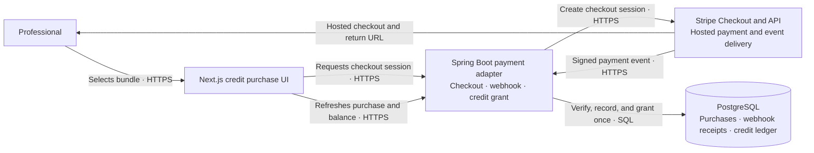
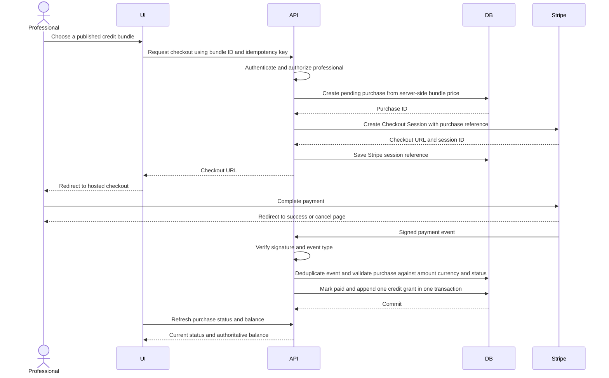

# Stripe — architecture and implementation plan

The semester scope includes implementing and demonstrating Stripe checkout, verified webhooks, and credit grants end to end in Stripe test mode. This plan scopes Stripe to purchasing lead-credit bundles only. Payments for client-professional services and Stripe Connect are separate product and compliance decisions.

## Scope and source of truth

Stripe will process payments for a defined credit bundle, using simulated payments in test mode for semester acceptance. The marketplace remains authoritative for the credit balance: a verified successful payment creates one credit-ledger grant, and lead purchases continue to debit credits through the existing atomic marketplace transaction. A browser redirect or client-side success message must never grant credits.

This plan assumes Stripe Checkout as the initial hosted payment experience, subject to a team decision. Card data stays with Stripe. Internal dispute decisions that refund virtual credits are not automatically Stripe refunds; that behavior requires a separate business and accounting policy.

## Developer setup: obtain Stripe test credentials

The local integration needs two server-side test credentials: a Stripe API secret key (`sk_test_...`) to create Checkout Sessions, and a webhook signing secret (`whsec_...`) to verify events. Do not put either value in frontend environment variables, source control, screenshots, logs, or chat. The application rejects live API keys.

1. **Create or open a Stripe account.** Sign in to the [Stripe Dashboard](https://dashboard.stripe.com/) and use a test/sandbox environment. Stripe may label this environment **Sandbox**; confirm that you are not viewing live data.
2. **Copy the test API secret key.** In that test environment, open **Developers → API keys** (or **Workbench → API keys**, depending on the Dashboard layout). Reveal and copy the **Secret key** beginning with `sk_test_`. Do not use the publishable key (`pk_test_`); this backend integration does not need it.
3. **Create the local environment file.** From the repository root, copy `.env.example` to `.env` if `.env` does not already exist. Set the following values in the root `.env` without quotes:

   ```dotenv
   STRIPE_SECRET_KEY=sk_test_paste_the_test_secret_here
   STRIPE_WEBHOOK_SECRET=
   FRONTEND_URL=http://localhost:3000
   ```

4. **Install and authenticate the Stripe CLI.** Follow Stripe's [official installation instructions](https://docs.stripe.com/stripe-cli#install), then open a terminal and run:

   ```powershell
   stripe login
   ```

   Complete the browser authorization for the same Stripe account and test environment.
5. **Start local webhook forwarding.** Keep this command running in its own terminal:

   ```powershell
   stripe listen --forward-to localhost:8080/api/payments/stripe/webhook
   ```

   The CLI prints a webhook signing secret beginning with `whsec_`. Copy that value into `STRIPE_WEBHOOK_SECRET` in the root `.env`. Use the secret printed by this local `stripe listen` command; it is distinct from any endpoint signing secret configured in the Stripe Dashboard. If you stop and restart the listener and it prints a different secret, update `.env` and restart the backend.
6. **Start or rebuild the Docker services.** From the repository root, run:

   ```powershell
   docker compose up --build
   ```

   Compose reads the root `.env` and passes the Stripe credentials to the backend container. Never pass these credentials as frontend build arguments or expose them as `NEXT_PUBLIC_*` variables.
7. **Make a test purchase.** Select a credit bundle in the app and complete the hosted Stripe **Sandbox** Checkout using a Stripe test card, for example `4242 4242 4242 4242`, a future expiry date, and any CVC. This simulates a payment and does not charge a real card.
8. **Confirm webhook delivery and the balance.** The Stripe CLI should report `checkout.session.completed` delivered with HTTP `200`; the app should show the purchase as paid and refresh the wallet. A `400` means the event was rejected and no credit grant should be assumed. After fixing the cause, resend the failed event from the Stripe Dashboard and confirm it returns `200`.

The browser success redirect is not proof of payment and never grants credits. Only the verified webhook updates the purchase and wallet. If running the backend outside Docker Compose, export the same variables in the backend process environment; Spring does not load the repository's `.env` file by itself.

## Logical architecture



The browser return is for user experience only. Stripe's signed webhook is the payment signal used to update the local purchase and credit ledger. Stripe secrets and webhook signing secrets remain on the backend.

## Checkout and credit-grant flow



Webhook processing must be idempotent across repeated deliveries. Enforce this in the database as well as application code, using a unique Stripe event ID and a unique credit grant per purchase. Validate the amount and currency against the server-side bundle and purchase record; never trust values supplied only by the browser or webhook metadata.

## Implementation plan

1. **Define semester scope and commercial rules.** Include the Stripe credit-bundle integration in the required semester implementation and acceptance criteria; define bundle sizes, prices, currency, taxes/receipts responsibilities, refund and chargeback policy, eligible account roles, and whether credits expire. Decide Stripe Checkout versus another Stripe-hosted flow. Exclude Connect and payments for services unless separately approved.
2. **Define the local payment contract.** Model an immutable credit bundle catalog, a pending/paid/failed/expired purchase lifecycle, provider references, and webhook processing receipts. Reuse the existing credit transaction ledger, adding a unique link from each successful purchase to exactly one grant. Add migrations and state-transition rules.
3. **Create checkout sessions.** Add an authenticated backend endpoint that accepts a bundle identifier, prices it from trusted server configuration, creates a pending purchase, and requests a Stripe Checkout Session. Use an idempotency key for retries. Return only the hosted checkout URL; do not accept arbitrary amounts from the frontend.
4. **Process payment webhooks.** Add a public, narrowly scoped webhook endpoint. Verify Stripe signatures against the raw request body, allowlist event types, deduplicate event IDs, validate session/purchase/amount/currency, and atomically mark the purchase paid and append its credit grant. Return retryable failures when the transaction cannot commit; acknowledge safely ignored duplicate or unsupported events.
5. **Build the purchase UI and status path.** Show available bundles, pending/success/cancel states, and refreshed balance/history. Treat the return URL as a status lookup only; show pending until the webhook has committed. Do not expose secrets or card data to Next.js.
6. **Test, reconcile, and release behind configuration.** Use Stripe test mode and webhook forwarding for local development. Cover duplicate/out-of-order events, invalid signatures, amount/currency mismatch, abandoned checkout, retries, and concurrent requests. Add operational visibility for stuck pending purchases and a reconciliation procedure before enabling live mode.

### Completion checks

- A checkout session can only be created for an authenticated, eligible professional and a server-defined bundle.
- No credits are granted from a redirect, unverified event, mismatched amount/currency, or failed payment.
- Replayed webhook events and repeated checkout requests cannot create duplicate purchases or credit grants.
- Purchase status and credit grant commit atomically, and existing lead-purchase debit behavior remains unchanged.
- Test-mode end-to-end coverage includes success, cancel/expiry, duplicate delivery, invalid signature, and provider/API failure.
- Live credentials, webhook secrets, and payment data are absent from source control, client bundles, and routine logs.

## Dependencies and rollout

Stripe depends on the virtual-credit balance and transaction ledger, authenticated professional accounts, and stable bundle/pricing decisions. Implement and test those marketplace capabilities first, then complete and demonstrate the Stripe integration within the semester. Test-mode delivery is mandatory; live-mode activation is a separate rollout decision and must remain disabled until webhook handling, reconciliation, refund policy, and deployment secrets are ready. The project proposal identifies Stripe Connect for possible future payments between clients and professionals; that is explicitly outside this plan.