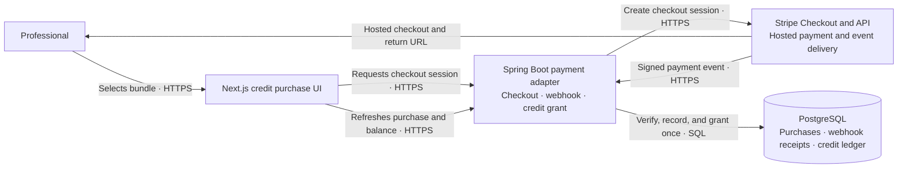
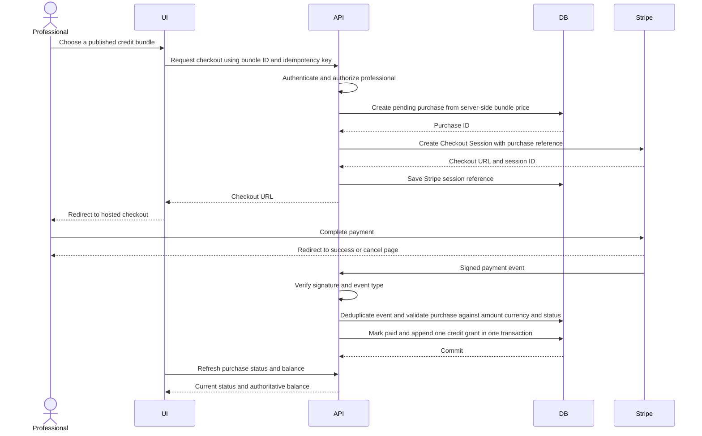

# Stripe — architecture and implementation plan

The semester scope includes implementing and demonstrating Stripe checkout, verified webhooks, and credit grants end to end in Stripe test mode. This plan scopes Stripe to purchasing lead-credit bundles only. Payments for client-professional services and Stripe Connect are separate product and compliance decisions.

## Scope and source of truth

Stripe will process payments for a defined credit bundle, using simulated payments in test mode for semester acceptance. The marketplace remains authoritative for the credit balance: a verified successful payment creates one credit-ledger grant, and lead purchases continue to debit credits through the existing atomic marketplace transaction. A browser redirect or client-side success message must never grant credits.

This plan assumes Stripe Checkout as the initial hosted payment experience, subject to a team decision. Card data stays with Stripe. Internal dispute decisions that refund virtual credits are not automatically Stripe refunds; that behavior requires a separate business and accounting policy.

## Logical architecture

The browser return is for user experience only. Stripe's signed webhook is the payment signal used to update the local purchase and credit ledger. Stripe secrets and webhook signing secrets remain on the backend.

## Checkout and credit-grant flow

Webhook processing must be idempotent across repeated deliveries. Enforce this in the database as well as application code, using a unique Stripe event ID and a unique credit grant per purchase. Validate the amount and currency against the server-side bundle and purchase record; never trust values supplied only by the browser or webhook metadata.

## Implementation plan

1. **Define semester scope and commercial rules.** Include the Stripe credit-bundle integration in the required semester implementation and acceptance criteria; define bundle sizes, prices, currency, taxes/receipts responsibilities, refund and chargeback policy, eligible account roles, and whether credits expire. Decide Stripe Checkout versus another Stripe-hosted flow. Exclude Connect and payments for services unless separately approved.
2. **Define the local payment contract.** Model an immutable credit bundle catalog, a pending/paid/failed/expired purchase lifecycle, provider references, and webhook processing receipts. Reuse the existing credit transaction ledger, adding a unique link from each successful purchase to exactly one grant. Add migrations and state-transition rules.
3. **Create checkout sessions.** Add an authenticated backend endpoint that accepts a bundle identifier, prices it from trusted server configuration, creates a pending purchase, and requests a Stripe Checkout Session. Use an idempotency key for retries. Return only the hosted checkout URL; do not accept arbitrary amounts from the frontend.
4. **Process payment webhooks.** Add a public, narrowly scoped webhook endpoint. Verify Stripe signatures against the raw request body, allowlist event types, deduplicate event IDs, validate session/purchase/amount/currency, and atomically mark the purchase paid and append its credit grant. Return retryable failures when the transaction cannot commit; acknowledge safely ignored duplicate or unsupported events.
5. **Build the purchase UI and status path.** Show available bundles, pending/success/cancel states, and refreshed balance/history. Treat the return URL as a status lookup only; show pending until the webhook has committed. Do not expose secrets or card data to Next.js.
6. **Test, reconcile, and release behind configuration.** Use Stripe test mode and webhook forwarding for local development. Cover duplicate/out-of-order events, invalid signatures, amount/currency mismatch, abandoned checkout, retries, and concurrent requests. Add operational visibility for stuck pending purchases and a reconciliation procedure before enabling live mode.

### Completion checks

- A checkout session can only be created for an authenticated, eligible professional and a server-defined bundle.
- No credits are granted from a redirect, unverified event, mismatched amount/currency, or failed payment.
- Replayed webhook events and repeated checkout requests cannot create duplicate purchases or credit grants.
- Purchase status and credit grant commit atomically, and existing lead-purchase debit behavior remains unchanged.
- Test-mode end-to-end coverage includes success, cancel/expiry, duplicate delivery, invalid signature, and provider/API failure.
- Live credentials, webhook secrets, and payment data are absent from source control, client bundles, and routine logs.

## Dependencies and rollout

Stripe depends on the virtual-credit balance and transaction ledger, authenticated professional accounts, and stable bundle/pricing decisions. Implement and test those marketplace capabilities first, then complete and demonstrate the Stripe integration within the semester. Test-mode delivery is mandatory; live-mode activation is a separate rollout decision and must remain disabled until webhook handling, reconciliation, refund policy, and deployment secrets are ready. The project proposal identifies Stripe Connect for possible future payments between clients and professionals; that is explicitly outside this plan.